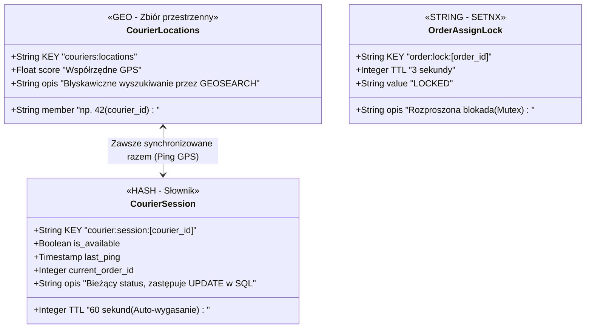

# Dokumentacja struktury danych - Redis

## 1. Rozwiązanie najbardziej problematycznego obszaru

W celu odciążenia bazy relacyjnej z operacji owysokiej częstotliwości zapisu i odczytu, zdecydowaliśmy się wykorzystać bazę danych in-memory - Redis. Wykorzystujemy go przede wszystkim do śledzenia geolokalizacji kurierów w czasie rzeczywistym oraz zarządzania krótkotrwałymi sesjami i rozproszonymi blokadami (ochrona przed race conditions).

## 2. Paradygmat: Redis vs PostgreSQL (SQL)

* **Struktura Klucz-Wartość:** Całą bazę traktujemy jak globalny zbiór zmiennych (słownik / hashmapę). Aby odczytać dane, nie wykonujemy zapytania `SELECT * FROM ... WHERE id = ...`, lecz pobieramy wartość przypisaną do konkretnego, unikalnego klucza (np. `courier:session:42`).
* **Trwałość vs Szybkość:** PostgreSQL zapisuje dane na dysku (trwałość transakcyjna ACID), natomiast Redis operuje w pamięci RAM. Odczyt i zapis trwają ułamki milisekund, co czyni go idealnym buforem dla danych ulotnych (np. bieżąca pozycja GPS), których ewentualna utrata nie zaburzy krytycznych procesów biznesowych.
* **Czas życia danych (TTL):** W SQL dane istnieją do momentu wywołania komendy `DELETE`. W Redisie niemal każdy klucz otrzymuje parametr TTL (Time-To-Live). Po upływie tego czasu serwer automatycznie usuwa dany klucz z pamięci.

## 3. Diagram Zarządzania Danymi Redis

Poniższy schemat przedstawia architekturę struktur danych w pamięci podręcznej.

## 4. Opis struktur w projekcie

### A. couriers:locations (Struktura GEO)

Aplikacja mobilna wysyła metadane GPS bezpośrednio do Redisa. Struktura `GEO` zachowuje się pod maską jak posortowany zbiór (Sorted Set) i korzysta ze zoptymalizowanych algorytmów przestrzennych.

* **Wykorzystanie:** Gdy zamówienie przechodzi w stan "W przygotowaniu", moduł przydziału wywołuje jedną komendę (np. `GEOSEARCH couriers:locations BYRADIUS 5 km`). Baza w czasie poniżej milisekundy zwraca listę ID najbliższych kurierów, całkowicie omijając obciążające zapytania przestrzenne w PostGIS.
* **Aktualizacja:** Wykonywana synchronicznie wraz z zapisem sesji kuriera (przy każdym pingu z aplikacji mobilnej).

### B. courier:session:[courier_id] (Struktura HASH)

Słownik przechowujący bieżący stan kuriera. Pozwala bez obciążenia bazy SQL wysyłać i odbierać zapytania o to, czy kurier jest zalogowany i wolny.

* **Mechanizm TTL (Time-To-Live):** Jest to kluczowa zaleta tego rozwiązania. Przy każdym przesłaniu lokalizacji, aplikacja ustawia TTL tego klucza na 60 sekund. Jeśli kurier straci połączenie z internetem (np. wjedzie do tunelu) lub jego aplikacja ulegnie awarii, pingi przestaną docierać. Po minucie Redis bezgłośnie i automatycznie usunie ten klucz. 
* **Korzyść biznesowa:** Moduł szukający kurierów opiera się tylko na istniejących sesjach. Eliminujemy w ten sposób ryzyko przypisania zamówienia do "martwego" kuriera bez pisania skomplikowanych skryptów czyszczących (cron jobs) w głównej bazie danych.

### C. order:lock:[order_id] (Rozproszona blokada / STRING)

Najprostszy typ danych (ciąg znaków), wykorzystywany do zabezpieczenia automatu stanów przed zjawiskiem wyścigu (race condition).

* **Problem:** Dwa niezależne procesy w tym samym ułamku sekundy mogłyby spróbować przypisać kurierów do tego samego zamówienia (np. jeśli klient ponowi żądanie lub nastąpi błąd w komunikacji).
* **Rozwiązanie:** Przed aktualizacją bazy PostgreSQL, system wykonuje w Redisie komendę `SETNX` (Set if Not eXists) dla klucza `order:lock:15`. Baza gwarantuje atomowość tej operacji - zablokuje zamówienie dla pierwszego procesu, a drugi otrzyma odmowę. 
* **Zabezpieczenie przed zawieszeniem:** Klucz ten otrzymuje bardzo krótki TTL (np. 3 sekundy). Nawet jeśli serwer ulegnie krytycznej awarii tuż po założeniu blokady i nie zdąży jej zdjąć, zamek samoczynnie zwolni się po 3 sekundach, odblokowując zamówienie.
